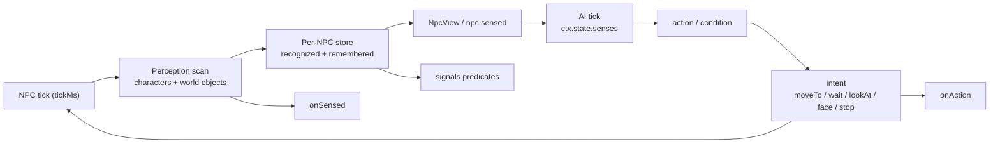

# NPCs and AI

The host owns movement, navigation and ZDO writes. Native bodies are instantiated by
`ZNetScene` only inside Valheim's active scene area around the server's reference position
(a connected player), so an NPC outside that area keeps its ZDO and intent but has no body until
a player comes near. The authority re-syncs the reference before every scene create/destroy pass
and replays the stored intent when the body is re-instantiated.

The pieces fit together in one loop:


## Capabilities, not behaviour

The host exposes facts and verbs: native hearing (`noise`, `audible`, `onHeard`), damage
(`onDamaged`), affordances (`npc.affordances`, `interact`) and the action primitives
(`moveTo`/`wait`/`face`/`pick`/`stop`). It never decides what those mean. Guard, villager,
animal and worker behaviours are plugin policy built from the same primitives.

## 1. Register and spawn

`npcBase()` returns the native base class. Call it while a plugin context is active, which means
inside `setup`, not at module scope:

```ts
import { authorityHandler, definePlugin, log, npc, npcBase, players } from "../../../sdk/index";

function makeWanderer() {
    const Base = npcBase();
    return class Wanderer extends Base {
        onTick() { this.idle(); }
    };
}

export default definePlugin({
    version: "1.0.0",
    setup() {
        npc.register(makeWanderer(), {
            kind: "wanderer",
            body: "human",
            tickMs: 500,
            faction: "Players"
        });
    },
    onServerTick: authorityHandler((ctx) => {
        if (ctx.state.spawned || !npc.available()) return;
        const player = players().online()[0] ?? players().local();
        if (!player) return;

        const entity = npc.spawn("wanderer", {
            position: { x: player.x + 3, y: player.y, z: player.z },
            name: "Wanderer"
        });
        if (entity) {
            ctx.state.spawned = true;
            log(`spawned ${entity.id}`);
        }
    })
});
```

`kind` is the plugin-facing name (`^[a-z0-9_-]{1,32}$`). Kind names are global: a second plugin
registering the same kind fails loudly instead of silently replacing the first. The prefab is
cloned once as `vjs_npc_<kind>`; `faction` sets the clone's `Character.Faction` (`"Players"` makes
a companion fight the same enemies players do). `tickMs` is clamped to 100..5000 and defaults to
500. `items` is a list of native item prefab names placed in the body inventory once, on first
spawn (for example `items: ["Club", "Raspberry"]`); the first weapon found is equipped.

Auto-combat is opt-in (`autoEngage: true`): when damaged by a non-player (or by a player while
tamed) the body fights back until the threat is gone. Without it the script always owns the
intent, and a damaged NPC keeps doing what the script asked. While an engaged body is fighting,
its intent reports `status: "paused"`, `reason: "combat"`; `view.combat` carries
`{ engaged, threatId }`. Issuing any intent (including `idle`/`stop`) cancels auto-combat.

## 2. What an NPC perceives

Each NPC owns a store, refreshed on demand (100 ms cache) when a hook or query reads it, so an
NPC with no script readers pays no scan cost. Entries are not just a snapshot: they stay after
the entity leaves range so the NPC can remember a lost target, a home, a chest or a player it
met before.

```ts
interface NpcSensed {
    id: string; name: string; kind: string; prefab: string | null; faction: string;
    pos: { x: number; y: number; z: number };   // last known world position
    rel: { x: number; y: number; z: number };   // relative to the NPC
    distance: number; bearing: number;          // bearing is signed from the NPC facing
    visible: boolean; inRange: boolean; ready: boolean; enemy: boolean;
    /** Native noise radius emitted by a character; 0 for objects. */
    noise: number;
    /** Native hearing rule: within the NPC hear range and within the target's noise radius. */
    audible: boolean;
    isPlayer: boolean; isNpc: boolean; isTamed: boolean; isDead: boolean;
    level: number; isObject: boolean;
    health: number; maxHealth: number;
    firstSeen: number; lastSeen: number;        // seconds since first/last contact (in range)
    seenCount: number;
}
```

`ready` means harvestable for pickables, alive for characters and `true` for other objects.
`audible` uses Valheim's own hearing rule: distance within the NPC's hear range (interior capped
at 12 m) and closer than the target's current noise radius. Characters make noise natively when
they attack, jump or land; `noise` is that radius. `perception.hearing` sets the hear range
(`0` uses `radius`). `npc.sensed(this, { audible: true })` filters to what the NPC can hear
without seeing.

`NpcView` is the self + store view your hooks receive:

```ts
interface NpcView {
    id: string; kind: string; x: number; y: number; z: number;
    health: number; maxHealth: number; isAlive: boolean;
    faction: string; isTamed: boolean; level: number;
    home: { x: number; y: number; z: number };
    combat: { engaged: boolean; threatId: string | null };
    self: NpcStats | null;       // live body stats; null while the body is culled
    action: NpcAction | null;    // current native action
    environment: { day: number; isDay: boolean; biome: string; weather: string | null } | null;
    nearby: NpcSensed[];      // current characters
    remembered: NpcSensed[];  // lost contacts, last-known positions
    objects: NpcSensed[];     // pickables, containers, doors, beds, stations, items...
}
```

`NpcStats` and `NpcAction` mirror the native body:

```ts
interface NpcStats {
    health: number; maxHealth: number; healthRatio: number;
    stamina: number; maxStamina: number; staminaRatio: number;
    eitr: number; maxEitr: number; eitrRatio: number;
    food: FoodSlot[];
    statusEffects: StatusEffect[];
    hungry: boolean;             // no active food slot
}

interface NpcAction {
    seq: number;                 // monotonic; increments on every issued intent
    kind: "idle" | "stop" | "moveTo" | "wait" | "lookAt" | "face" | "pick" | string;
    status: "idle" | "running" | "paused" | "arrived" | "failed" | "cancelled";
    reason: string | null;
    target: { x: number; y: number; z: number } | null;
    targetId: string | null;
    progress: number | null;     // 0..1 for a running moveTo, 1 on arrival
}
```

Tune the scan per kind:

```ts
npc.register(makeWanderer(), {
    kind: "wanderer",
    body: "Dverger",
    tickMs: 500,
    perception: {
        radius: 24,          // character scan radius
        max: 12,             // entries in view.nearby
        viewRange: 24,       // sight range
        viewAngle: 90,       // half-angle; 90 = front hemisphere
        lineOfSight: true,   // raycast against terrain/pieces
        includePlayers: true,
        includeCreatures: true,
        includeTamed: true,
        includeNpcs: true,
        includeDead: false,
        objectRadius: 12,    // enables the world-object scan
        objectMax: 8
    }
});
```

`enemy` uses the game's faction matrix (`BaseAI.IsEnemy`), including tamed and group overrides.
World objects are the same record shape with `isObject: true` and `kind` set to `pickable`,
`tree`, `rock`, `container`, `door`, `bed`, `smelter`, `station`, `item` or `portal`.
`ready` is the harvestable flag for pickables (read from the ZDO even while culled), alive for
characters, and `true` for other objects.

## 3. Query the store

Do not scan `view.nearby` manually when a filter is enough:

```ts
npc.sensed(this, { radius: 12, dir: { x: 0, z: 1 }, angle: 45, kinds: ["player"] });
npc.sensed(this, { enemy: true, visible: true });
npc.sensed(this, { kinds: ["container"] });                  // world objects when objectRadius > 0
npc.sensed(this, { remembered: true, max: 64 });             // includes lost contacts
```

`dir` defaults to the NPC facing and `angle` is a half-angle. `kinds` accepts `player`, `npc`,
`creature`, `tamed`, `enemy`, `dead`, or an exact kind/prefab/object class. Results are sorted by
distance and capped by `max` (default 32).

Recognition data lives in the entry (`firstSeen`, `lastSeen`, `seenCount`). Facts that are not
derived from the game, such as ownership or interaction history, belong in memory (next section),
not in the transient store.

## 4. Drive the NPC

Native actions are asynchronous. `moveTo`, `wait`, `lookAt`, `face` and `pick` return an
`ActionResult` (`{ ok, reason, count? }`) and report progress through `view.action`:

```ts
interface ActionResult {
    ok: boolean;                 // true only when the whole request was applied
    reason: string | null;       // "partial" when count is smaller than requested
    count?: number;              // items added/removed
}
```

```ts
onSpawn() {
    const result = this.moveTo(120, 8, -40, false);
    if (!result.ok) log(`move refused: ${result.reason}`);
}
onTick(view: NpcView) {
    if (view.action?.status === "arrived") this.idle();
}
onAction(view: NpcView, action: NpcAction) {
    if (action.status === "failed" || action.status === "cancelled") {
        log(`#${action.seq} ${action.kind} ${action.status}: ${action.reason}`);
    }
}
```

`onAction` fires exactly once per settled action and is edge-driven, so two actions that both
arrive are both reported. Issuing a new intent cancels the in-flight one first: its
`onAction` reports `cancelled` with reason `superseded`. A body cull pauses the action
(`reason: "body-pending"` before the first body, `"body-lost"` after one was attached) and it
resumes when the body returns. `moveTo` fails with `nav-unreachable` when the navmesh has no
path and the target is far, `nav-incomplete` when the path ends short, `nav-timeout` after the
60-second intent deadline, and `nav-stuck` when the body cannot make progress.

`onHeard(entry)` fires once when a character becomes audible (native noise rule) and
`onDamaged(event)` fires from the native damage callback:

```ts
onDamaged(hit: NpcDamageEvent) {
    log(`hit by ${hit.attackerName} for ${hit.damage} (${hit.health}/${hit.maxHealth})`);
}
onHeard(entry: NpcSensed) {
    if (entry.isPlayer) this.face(entry.id);
}
```

`onSpawn` fires for instances created by this host (the authority's `npc.spawn`). Entities a
client discovers already existed, so the first hook there is `onRehydrate`.

### Body, inventory and world interaction

The same accessor backs NPC inventories and world containers; the provider decides which verbs
are legal. Bodies support item and equipment verbs; containers are read-only and report
`not-supported` for mutations and `null` for `equipment`.

```ts
const inventory = npc.inventory(this);       // owned body inventory
const chest = npc.container(chestId);        // world container

inventory.has("CookedMeat");                 // query
inventory.count("Wood");
inventory.items;                             // snapshots with slot/prefab/type/food/...
inventory.equipmentSupported;                // false for containers
inventory.canConsume(item);                  // mirrors vanilla CanEat

inventory.use(item);                         // food/mead → consume; gear → equip
inventory.equip(item);
inventory.unequip(item);
inventory.drop(item, 1);

npc.stats(this);                             // live NpcStats
npc.pick(this, berryId);                     // native pick + auto-pickup
```

`add`/`remove` add or remove as much as fits and report `{ ok: false, reason: "partial",
count }` when the request could not be fully applied; `ok` means the whole request succeeded.
Equipment is restored by item identity, so a saved body re-equips after a cull even if its slot
changed. Stats simulate on the world authority; clients read the last persisted ZDO snapshot.

The same accessor reports `available`, `kind`, `writable`, `weight`, `capacity`, `freeSlots`,
`items`, `equipment`, and `has/count/add/remove/use/consume/equip/unequip/drop`. Container
writes are reserved until ownership/access is defined; the capability flags tell a script what
the provider supports.

### Interactions and affordances

Perceive first, then ask what the target supports:

```ts
const chest = npc.sensed(this, { kinds: ["container"] })[0];
npc.affordances(this, chest.id);
// { kind: "container", verbs: ["store","take"], supported: true, inRange: true, ... }
this.interact(chest.id, { verb: "store", prefab: "Wood", count: 10 });
this.interact(chest.id, { verb: "take", name: "$item_cookedmeat", count: 1 });
```

Supported verbs: `pick` (pickables), `store`/`take` (containers, direct item transfer),
`addOre`/`addFuel` (smelters via their native RPCs), and `use`/`open`/`close`/`toggle` for native
interactables such as doors, fireplaces, beehives, item stands, armor stands, chairs and vagons.
`hoverName`/`hoverText` are included for UI parity.

Player/UI-only components are refused with `player-only` rather than opening a GUI: beds,
crafting stations, cooking stations, portals and traders. `Bed.Interact`,
`CraftingStation.Interact`, `Container.Interact` and `TeleportWorld.Interact` assume
`Player.m_localPlayer`, `InventoryGui` or `TextInput`, so a plain NPC body must not call them.
Interactions run server-side, require 3.5 m range and claim ZDO ownership first. Failures carry a
reason: `out-of-range`, `not-loaded`, `no-access`, `rejected`, `no-item`, `no-room`,
`verb-required`.

### Core blackboard

`npc.boardGet`, `npc.boardSnapshot`, `npc.boardOnChange` and `npc.boardOff` expose the
core-owned per-NPC board (one reactive Blackboard channel per NPC). Core publishes `ready`,
`action`, `combat`, `self` and `hungry` when they change; plugin boards
(`ai.board.local(...)`) remain separate. Subscribe from a plugin to mirror core state or
react without polling:

```ts
const off = npc.boardOnChange(this, "", (key, value) => {
    if (key === "action") log(`action changed: ${JSON.stringify(value)}`);
});
```

## 5. Memory: what the NPC owns and remembers

The store is host-side recognition data. Persistent plugin data goes in one JSON object per NPC:

```ts
const memory = npc.memory(this);
const player = npc.sensed(this, { players: true })[0];
if (player) memory.owner = player.id;             // ZDO id; resolve accounts separately
memory.interactions = {
    ...(memory.interactions as Record<string, number> ?? {}),
    [chestId]: Date.now()
};
npc.setMemory(this, memory);
```

`npc.memory` is stored in the NPC ZDO (`vjs.memory`, 16 KiB JSON limit), so it survives restarts and
relevance changes. Use it for ownership, interaction history, quest state and arbitrary facts.
Use `state(key)`/`setState(key, value)` for small string keys; use `npc.memory` for structured data.

### Orphan cleanup

Scripted NPC ZDOs carry `vjs.sim`, `vjs.plugin` and `vjs.kind`. After plugins load, and periodically
thereafter, the server removes VJS-marked ZDOs whose plugin/kind is no longer registered. That
prevents old demo or removed-plugin NPCs from producing client “missing prefab” spam and staying
in the save forever. Pre-marker `vjs_npc_wanderer` objects are handled by a legacy hash fallback;
a prefab hash alone cannot be decoded into a `vjs_*` name.

## 6. Signals observe the same store

Signals sample on the host pump. Because perception is cached on the NPC tick, predicates can
query it cheaply:

```ts
import { signals } from "../../../sdk/index";

const observer = signals({ intervalMs: 250 });
observer.observe("hunter-threat", () =>
    npc.handles("hunter").some((entity) =>
        npc.sensed(entity, { enemy: true, visible: true, radius: 24 }).length > 0));
observer.on("hunter-threat:Enter", () => log("a hunter sees an enemy"));
```

For one NPC, keep the entity in plugin state and use `npc.sensed(entity, ...)`. Signals are
plugin-wide; if you need per-entity edges, include the entity id in the condition name or maintain
a dictionary in `ctx.state`.

## 7. Behaviour trees bridge into the NPC

`ai` compiles YAML once and runs one instance per entity. When `instantiate` receives a `this`
with a string `id` (a `ValheimBaseNPC`), the NPC's perception is injected as
`ctx.state.senses` before every tick. YAML can reference it (`@[senses.nearby.0.id]`); JS
callbacks can read it directly.

A tree:

```yaml
id: hunter
state:
  chasing: false
root:
  type: selector
  children:
    - condition: threat
      true:
        action: chase
    - action: wander
```

The matching JS actions live in the plugin. `chase` is responsible for its own long-running
intent: issue `moveTo`, return `running` while it is active, and return success only once the
NPC has arrived.

## 8. Planning is plugin policy

`Planner` is an optional, policy-free scheduler: it scores plugin-supplied goals, runs the
highest-scoring one, preempts with optional hysteresis, and applies optional cooldowns. It has no
built-in goals or reactions; the plugin owns interpretation, priorities and callbacks.

```ts
import { Planner, type Goal, type NpcView } from "../../../sdk/index";

const goals: Goal[] = [
    {
        id: "investigate",
        score: view => view.nearby.some(entry => entry.audible && !entry.visible) ? 60 : 0,
        tick: ctx => {
            const noise = ctx.view.nearby.find(entry => entry.audible && !entry.visible);
            if (!noise) return "failure";
            ctx.moveTo(noise.pos.x, noise.pos.y, noise.pos.z, true);
            return "running";
        }
    },
    {
        id: "work",
        score: () => 40,
        tick: () => "running"
    }
];

const planner = new Planner(this, { log: message => log(message) }); // inside the NPC class
planner.setGoals(goals);
// in onTick: planner.tick(view);
```

The same primitives support every policy without core changes:

- **Villager**: investigate the noise, open the door, return home.
- **Guard**: investigate, then raise an alarm.
- **Animal**: flee instead.
- **Worker**: ignore it while `work` scores higher.

`onHeard` and `onDamaged` are the edges; `affordances`/`interact` are the verbs; the choice
between fleeing, investigating and ignoring belongs to the plugin.

## 9. Full plugin: a companion hunter

```ts
import {
    ai,
    authorityHandler,
    definePlugin,
    log,
    npc,
    npcBase,
    players,
    signals,
    type AiActionOutcome,
    type NpcAction,
    type NpcSensed,
    type NpcView
} from "../../../sdk/index";

const HUNTER_TREE = `
id: hunter
state:
  chasing: false
root:
  type: selector
  children:
    - condition: threat
      true:
        action: chase
    - action: wander
`;

function makeHunter(tree: string, tickSeconds: number) {
    const Base = npcBase();
    return class Hunter extends Base {
        private brain = "";

        onSpawn(_view: NpcView) { this.ensureBrain(tree, tickSeconds); }
        onRehydrate(_view: NpcView) { this.ensureBrain(tree, tickSeconds); }
        onSensed(entry: NpcSensed) {
            if (!entry.isPlayer) return;
            const memory = npc.memory(this);
            memory.lastPlayer = { id: entry.id, name: entry.name, at: Date.now() };
            npc.setMemory(this, memory);
        }
        onAction(_view: NpcView, action: NpcAction) {
            if (action.status === "failed") log(`hunter ${this.id}: ${action.reason}`);
        }
        onTick(_view: NpcView) {
            if (!this.brain) this.ensureBrain(tree, tickSeconds);
            const result = ai.tick(this.brain, tickSeconds);
            if (result.status === "failure") log(`hunter ${this.id}: tree failed`);
        }
        onDespawn() { ai.release(this.brain); this.brain = ""; }

        private ensureBrain(tree: string, tickSeconds: number) {
            if (this.brain) return;
            this.brain = ai.instantiate(tree, {
                this: this,
                condition: (name, ctx): boolean => {
                    if (name !== "threat") return false;
                    const senses = ctx.state.senses as NpcView | undefined;
                    return !!senses && senses.nearby.some((entry) => entry.enemy && entry.visible);
                },
                action: (name, ctx): AiActionOutcome => {
                    if (name === "wander") {
                        return npc.perception(this)?.intent?.kind === "idle"
                            ? "success"
                            : this.idle() ? "success" : "failure";
                    }
                    if (name !== "chase") return "success";

                    const senses = ctx.state.senses as NpcView | undefined;
                    const target = senses?.nearby.find((entry) => entry.enemy && entry.visible);
                    if (!target) { ctx.state.chasing = false; return "failure"; }

                    const intent = npc.perception(this)?.intent;
                    if (ctx.state.chasing) {
                        if (intent?.status === "running") return "running";
                        ctx.state.chasing = false;
                        return intent?.status === "arrived" ? "success" : "failure";
                    }

                    if (this.moveTo(target.pos.x, target.pos.y, target.pos.z, true)) {
                        ctx.state.chasing = true;
                        return "running";
                    }
                    return "failure";
                }
            });
        }
    };
}

export default definePlugin({
    version: "1.0.0",
    setup() {
        const tickMs = 500;
        const tree = ai.compile(HUNTER_TREE, { source: "hunter.yaml" });
        npc.register(makeHunter(tree, tickMs / 1000), {
            kind: "hunter",
            body: "human",
            tickMs,
            faction: "Players",
            perception: {
                radius: 24, max: 12, viewRange: 24, viewAngle: 90,
                lineOfSight: true, objectRadius: 12, objectMax: 8
            }
        });

        const observer = signals({ intervalMs: 250 });
        observer.observe("hunter-threat", () =>
            npc.handles("hunter").some((entity) =>
                npc.sensed(entity, { enemy: true, visible: true, radius: 24 }).length > 0));
        observer.on("hunter-threat:Enter", () => log("a hunter sees an enemy"));
    },
    onServerTick: authorityHandler((ctx) => {
        if (ctx.state.spawned || !npc.available()) return;
        const player = players().online()[0] ?? players().local();
        if (!player) return;

        const entity = npc.spawn("hunter", {
            position: { x: player.x + 3, y: player.y, z: player.z },
            name: "Hunter"
        });
        if (entity) {
            ctx.state.spawned = true;
            log(`spawned ${entity.id}`);
        }
    })
});
```

The tree and the NPC have separate lifetimes: `ai` owns the compiled definition and instance,
`npc` owns movement, ZDO persistence and the perception store. `ai.release` on despawn prevents
the brain from leaking after the entity is removed.

## Example: a villager with a life

`scripting/testing/life-demo` is a complete utility-driven example with a deliberately split brain:

- **Brain** (`lib/brain.ts`) owns needs, eligibility, utility scoring, interruption, memory and AI
  instance lifecycle. It picks one activity at a time, then ticks the matching YAML tree with
  `ai.instantiate`/`ai.tick`/`ai.release`.
- **YAML behaviours** (`behaviours/*.yaml`) own *how* the activity runs. `wander`, `forage`,
  `return-home`, `rest`, `seek-home`, `inspect`, `socialize` and `flee` compose the micro trees in
  `behaviours/micro/` (`move`, `wait`, `look`, `look-around`, `face`, `claim`).
- **Loader** (`lib/behaviours.ts`) reads the YAML text from the plugin folder through `importText`
  and compiles each activity once in setup; the YAML ships as files rather than source strings.

The activity names are also the manual/LLM vocabulary: `brain.request(activity, target?)` cancels
the current tree and runs one activity before normal selection resumes.

- Needs (`energy`, `social`, `curiosity`) drift every tick; behaviours satisfy or spend them.
- `seek-home` claims a visible empty `bed`/`door` as the persistent home.
- `forage` walks 10–18 m from home, looks around and lowers curiosity; `return-home` scores higher
  once the villager is far away, it is getting dark or energy is low.
- Recognition facts live in `npc.memory` (`home`, `shelter`, `visited`, `blocked`, `lastMet`), so a
  reload or restart resumes the same life.
- **Hot state** lives in a per-villager blackboard scope (`ai.board.local('npc:<id>')`): `activity`,
  `needs`, `threat`, `home`, `sheltered` and transitions such as `activity:start`/`activity:complete`.
  The brain publishes; the YAML trees still own execution.
- **Shared coordination** uses `ai.board.join('village:life-demo')`. Each villager joins on spawn,
  publishes `villager:online`/`threat:seen`, and translates another villager's threat signal into
  its own local `heard:threat` event. It does not copy the other villager's state.
- **Lifetime** is explicit: `BoardMembership.dispose()` drops shared subscriptions, and
  `local.release()` drops the per-villager channel on despawn.

```ts
const local = ai.board.local(`npc:${view.id}`);
const village = ai.board.join("village:life-demo");

local.onSignal("threat:seen", (_name, threat) => {
    village.emit("threat:seen", { sourceId: view.id, threat });
});
village.onSignal("threat:seen", (_name, data) => {
    if (data && typeof data === "object" && !("sourceId" in data && data.sourceId === view.id)) {
        local.emit("heard:threat", data);
    }
});
```

Tests: `scripting/test/life-demo.test.ts` covers brain selection/lifecycle and board publication;
`scripting/test/board.test.ts` covers scope/membership lifetime; `task probe:life` compiles the real
YAML files and asserts each activity's composed action sequence.

## Authority, cadence and limits

- **Server only.** Spawning, actions, perception and memory writes are authority-side. Clients
  receive the replicated pose and can read `npc.perception`/`npc.handles` for presentation.
- **Cadence.** `tickMs` is clamped to 100..5000; the host pump is the floor. The AI tick interval
  is whatever your plugin passes to `ai.tick`; keep it aligned with `tickMs / 1000`.
- **Store retention.** Recognized entries survive 5 minutes out of range, then are pruned.
  `npc.memory` is durable until you change or clear it.
- **Limits.** 32 live NPCs per kind per plugin; 16 KiB memory JSON; perception filters cap results
  (`max`, default 32).
- **Combat.** Native auto-combat is opt-in per kind (`autoEngage`); there are no scripted attack
  verbs. Do not fake attacks by writing health or teleporting.
- **Interaction.** Inventory queries/mutations and `pick` exist; building, crafting, taming and
  social interaction verbs do not. Add a native action first, then expose it through
  `ValheimBaseNPC`.

## Debugging

```ts
npc.debug(true);    // lifecycle, new senses, settled intent reason/target
ai.debug(true);     // tree filename, nodes, actions, conditions, imports
log(JSON.stringify(npc.perception(this), null, 2));
log(npc.sensed(this, { remembered: true, max: 64 }));
log(ai.status(this.brain));
```

An `ai.debug(true)` trace looks like:

```text
[ai] tree forage.yaml
[ai] sequence
[ai]   action select-point
[ai]   done action select-point success
[ai]   use move
[ai]   action move-to
[ai]   done action move-to success
[ai]   done use move success
[ai]   use look-around
[ai]   action look-around
...
```

`npc.debug(true)` adds lines such as `intent moveTo failed reason=nav-unavailable target=12,-4 id=-`
and `sensed Dverger Rogue (creature) distance=8.2 enemy=true`. Both flags are per plugin and off by
default; `life-demo` reads `debug=true` from its config.

Use `task probe:ai` for the binding and perception-model contract, `task probe:behaviour` for the
YAML engine, and `task probe:life` for the composed behaviour library.
